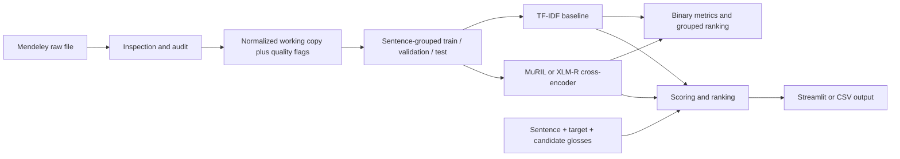

# MarathiSense

Reproducible Marathi word sense disambiguation (WSD) as binary sentence–gloss compatibility classification, with candidate ranking at inference time.

## Dataset: source description and observed audit

The [Mendeley Data record](https://data.mendeley.com/datasets/499w76zjn2/1) identifies version 1 (DOI `10.17632/499w76zjn2.1`), CC BY 4.0. Its description declares 50,242 binary sentence–gloss pairs, 16 ambiguous Marathi words, 50 senses, and seven fields: `sentence`, `target_word`, `lemma`, `pos`, `sense_id`, `gloss`, and `label`. Label 1 denotes a matching sentence/sense gloss; label 0 denotes an incorrect pairing. The description says target words and glosses are derived from Marathi WordNet and that examples include naturally collected and reviewed/generated seed sentences.

The downloaded dataset was inspected from the Kaggle run outputs. The file matched all seven required columns and had 50,242 rows, 16 target words, 50 senses, no missing task fields, and labels 0/1. The audit found 3,252 exact duplicate rows and 2,900 identical sentence/target/lemma/POS/sense/gloss pairs carrying both labels, across 1,092 sentence/target contexts. It also flagged 13,612 rows where the lemma string is not an exact sentence substring. Sample review shows expected inflected forms (for example, `डोळा` in `डोळे` or `डोळ्यासमोर`); the Mendeley description says Stanza lemmatization and prefix matching were used, so these flags are not a deletion rule.

The project keeps the source data unchanged and provides a conservative, separate clean-data candidate in `outputs/analysis/marathi_wsd_clean_candidate.csv`. It deduplicates identical same-label pair rows and excludes complete sentence/target contexts with contradictory pair labels. It retains 13,518 contexts with complete candidate inventories and exactly one positive sense each. This is a provisional experiment, not an adjudication of source labels. Review `outputs/analysis/data_quality_review.md` before interpreting scores.

To inspect a newly downloaded copy:

```bash
python scripts/download_dataset.py
# If the endpoint is blocked: use Download All at the Mendeley page,
# extract the archive, then put the supported tabular file in data/raw/.
python scripts/inspect_dataset.py --input data/raw
python scripts/prepare_dataset.py --input data/raw
```

Supported tabular formats: CSV, TSV, JSON, JSONL, XLSX, and Parquet. Raw data is git-ignored. Preparation writes a separate normalized working copy, keeps the original labels, and attaches `_validation_issues` so flagged rows can be reviewed rather than silently removed.

## Environment

Python 3.10–3.12 is recommended for current PyTorch/Transformers wheels. This laptop was checked with Python 3.13.2, PyTorch 2.9.0+cu130, Transformers 4.57.1, and CUDA on an NVIDIA RTX 3050 Laptop GPU (4 GiB VRAM). A CUDA forward/backward smoke check passed. Check your current versions with:

```bash
python -m pip install -r requirements.txt
python scripts/check_environment.py
python scripts/check_gpu.py
```

The transformer checkpoint files require network access once to download. The project does not call paid APIs. The TF-IDF baseline and app can run on CPU. For reproducible model comparisons, set the seed and use the same sentence-grouped splits. Since CUDA already works on this laptop, do not reinstall PyTorch unless `scripts/check_environment.py` reports CUDA unavailable. Install dependencies with `python -m pip install -r requirements.txt` (includes PEFT for low-memory LoRA fine-tuning). `scripts/check_gpu.py` verifies a small LoRA + mixed-precision optimizer step entirely offline; it does not download or train the WSD model.

## Large files and Git

The repository keeps source code, configuration, and documentation in Git. Datasets, checkpoints, model weights, archives, and generated experiment outputs are excluded and remain in the local project folder. See [LARGE_FILES.md](LARGE_FILES.md) for the excluded paths, approximate sizes, and how to restore or regenerate them. A fresh clone needs the dataset and any desired checkpoints separately before it can reproduce trained-model inference.

## Run the baseline

```bash
python scripts/train_all.py --input data/processed/marathi_wsd.csv
```

This makes reproducible 70/15/15 train/validation/test sentence-grouped splits by default, trains TF-IDF word and character n-grams plus balanced logistic regression, selects no model based on test scores, writes the baseline checkpoint to `checkpoints/baseline.joblib`, and saves measured metrics to `outputs/metrics/model_comparison.json`. Stratification is not guaranteed by the grouped splitter; inspect split label distributions before interpreting metrics.

## Transformer comparisons

The shared training code uses `AutoTokenizer` and `AutoModelForSequenceClassification` as a cross-encoder: the marked sentence, target, lemma, and POS form one sequence; the candidate Marathi gloss is the paired sequence. Training uses dynamic padding, AdamW, linear warmup/decay, validation macro-F1 checkpoint selection, early stopping, seeded runs, and CUDA mixed precision when available. For the laptop’s 4 GiB GPU, defaults use LoRA adapters, gradient checkpointing, micro-batch size 1, and gradient accumulation of 8 (effective batch size 8). Checkpoint loading supports the saved PEFT adapter. This configuration is designed to reduce VRAM; peak usage depends on other GPU applications and sequence lengths.

```bash
python scripts/train_all.py --input data/processed/marathi_wsd.csv --transformer --model google/muril-base-cased
python scripts/train_all.py --input data/processed/marathi_wsd.csv --transformer --model FacebookAI/xlm-roberta-base
```

MuRIL’s model card names Marathi among its supported languages and lists Apache-2.0. XLM-R base lists 94 languages and MIT. Both are multilingual; neither is represented here as Marathi-only. [MuRIL model card](https://huggingface.co/google/muril-base-cased), [XLM-R base model card](https://huggingface.co/FacebookAI/xlm-roberta-base). The original October 2026 Kaggle run trained both the TF-IDF baseline and a MuRIL LoRA adapter on a Tesla T4. Its saved metrics remain in `MarathiSense-Kaggle-outputs`. The later clean-candidate run supplied checkpoints and processed data but its metrics report was missing from the downloaded artifacts.

For Colab, the same settings work as a conservative starting point; a larger GPU can use a larger micro-batch and shorter accumulation. Change these in `configs/config.yaml`. Checkpoint, training history, timing, fine-tuning mode, and device information are recorded. Resume support is via saving the best checkpoint; optimizer-state resume is not implemented.

## Inference

Candidate definitions must be provided manually or drawn from an explicitly supplied local dataset. This repository does not claim a live Marathi WordNet integration. Dataset-derived candidate lookup is labeled as such. The scorer ranks candidate compatibility scores and returns the selected definition, raw score, score margin, and uncertainty warning. Scores are not calibrated probabilities.

```bash
python scripts/run_demo.py "त्याने नदीच्या काठावर घर बांधले." काठ "नदीची सीमा" "कपड्याची सजावटीची किनार"
```

Inference target matching is exact, case-sensitive NFC substring matching; stemming, lemmatization, and prefix matching are not done at inference. Repeated exact occurrences can be selected in the API and UI. During corpus training, an unmarked sentence is retained if the target field is not an exact substring, since the source describes morphological and prefix-based target discovery; target/lemma metadata is still included as model input. These mismatches are reported for review. Transliteration is not claimed as supported.

## Streamlit app

```bash
streamlit run app/streamlit_app.py
```

The UI defaults to the latest Kaggle clean-candidate TF-IDF model at `checkpoints/kaggle_clean_candidate/baseline.joblib`; the earlier `checkpoints/baseline.joblib` is preserved. The Kaggle MuRIL LoRA adapter is installed at `checkpoints/muril`. Select `transformer` in the sidebar to use it; its base model (`google/muril-base-cased`) must be cached locally or downloaded from Hugging Face the first time. The UI provides single-sentence scoring, a per-occurrence selector, candidate glosses, batch CSV processing and download, and checkpoint/metrics information. Batch CSV requires `sentence`, `target_word`, and pipe-separated `candidate_definitions`; optional `occurrence` is one-based. The model is cached while the Streamlit session is active.

The separate **SenWiCh WiC** tab compares two contexts for one lemma and predicts whether the lemma is used in the same sense. Its adapter and tokenizer are installed at `checkpoints/senwich_marathi_wic`; MuRIL's base model must be available from the local Hugging Face cache or downloaded on first use. The Kaggle held-out test report gives 76.8% accuracy, 0.767 macro-F1, and 0.836 ROC-AUC on 4,194 official Marathi test pairs. These metrics belong to the WiC task and must not be compared directly with sentence–gloss ranking scores. Scores shown by the app are not calibrated. The downloaded report is at `outputs/senwich_kaggle/senwich_marathi_wic/metrics.json`.

### Imported `wsd_outputs` checkpoints

The imported sentence–sense experiment is available in the main app by selecting **wsd_outputs**. The default checkpoint is `wsd_outputs/models/IndicBERT-v2.pt`; the other supported files are `MahaBERT-v2.pt`, `MahaRoBERTa.pt`, and `XLM-R-large.pt`. Checkpoints are loaded from that folder in place and are not copied into `checkpoints/`. These weight files do not include tokenizer/config files, so the matching Hugging Face tokenizer and config are fetched or loaded from cache on first use. The cleaned training records contain sentence, lemma, and sense ID fields, but no definitions. The app therefore scores sentence/lemma/sense-ID pairs; enter each candidate as `sense_id | optional definition` in the UI, or use semicolon-separated candidates in batch CSV. Definitions are displayed as labels only. The resulting sigmoid scores are raw ranking scores, not calibrated probabilities.

The model metadata and reported results are in `wsd_outputs/results_table.csv` and `wsd_outputs/results/*.pkl`. That experiment reports its own test and silver-set evaluation; its splits and task setup differ from the project's sentence–gloss Kaggle and clean-candidate runs, so the figures should be read separately. `XLM-R-large.pt` is about 2.2 GB and can exceed the memory available on a small GPU; start with the default IndicBERT-v2 checkpoint on this laptop.

## Evaluation and leakage controls

Binary metrics include accuracy, precision, recall, F1, macro-F1, weighted-F1, confusion matrix, per-class report, and ROC-AUC where defined. Candidate ranking groups by sentence and target word, then checks whether the top scored row is labeled positive; macro accuracy is averaged across target words. Since the published schema has no stable original-instance ID, the grouping is an approximation. All pairs sharing the exact sentence string are kept together, but near-duplicate leakage is not detected automatically. The target-word-held-out experiment is not implemented because source sentence/sense group structure has not been inspected; only run it after a valid design is justified.

Never use the test split for checkpoint selection. Compare binary pair classification and WSD ranking separately. Inspect the audit JSON, group-level split class coverage, and `outputs/metrics/model_comparison.json` before reporting results.

## Architecture



## Report-ready methodology and preliminary results

Each source row is one binary sentence–gloss pair. The classifier estimates compatibility for that pair; at inference time it scores all candidate definitions for the user’s target instance and sorts them. This avoids confusing binary pair classification with direct multiclass sense classification. The traditional baseline concatenates marked sentence context, target, lemma, POS, and gloss into word/character TF-IDF features and fits logistic regression. Transformer models jointly encode sentence context and a candidate gloss through paired inputs. Splits group by full sentence so gloss pairs from one sentence cannot cross partitions. Validation macro-F1 selects checkpoints; the held-out test split is used once for final evaluation.

On the original Kaggle run, baseline test binary macro-F1 was 0.772 and WSD top-1 accuracy was 0.770 (macro accuracy across target words 0.581). MuRIL test binary macro-F1 was 0.764 and WSD top-1 accuracy was 0.721 (macro accuracy across target words 0.458). The baseline led on these reported metrics. The separate local clean-data baseline comparison uses the same retained test contexts and is documented in `outputs/analysis/baseline_comparison.json`; it did not improve the TF-IDF baseline. Scikit-learn versions differ between Kaggle and the local comparison, so those experiments should not be conflated.

Limitations include source-generated or heuristically assigned labels described by the dataset record, unresolved contradictory pair labels, exact-string target matching at inference, possible false positives in candidate ranking if candidate sets are incomplete, approximate grouping without a source instance ID, and no calibrated uncertainty. Future work includes a MuRIL run on the conservative clean-data candidate, review of annotation provenance, near-duplicate analysis, reliable Marathi WordNet retrieval after licensing/API validation, calibration on validation data, and a justified held-out-lemma generalization study.

## Repository map

- `src/`: loaders, Unicode handling, validation, baseline, transformer, evaluation, inference, candidate source.
- `scripts/`: dataset retrieval/inspection/preparation, environment check, training, CLI demo.
- `app/streamlit_app.py`: UI, separate from model logic.
- `tests/`: loader, split, preprocessing, and inference unit tests.
- `configs/config.yaml`: experiment defaults.
- `scripts/kaggle_run.py` and `KAGGLE.md`: GPU notebook runner and Kaggle setup.
- `outputs/`: generated audit and metrics; excluded from Git.

Run unit tests with `python -m pytest -q`. The repository pytest settings disable its cache and temporary-directory plugins because neither is needed by these tests.

